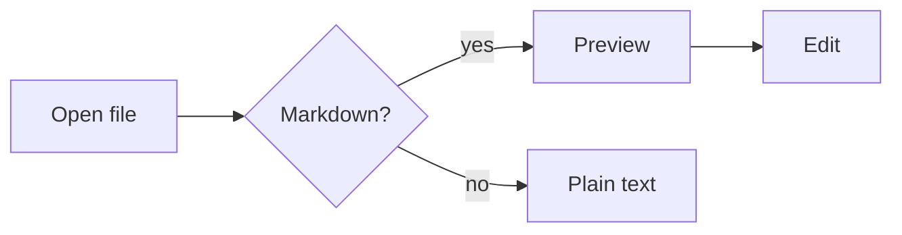
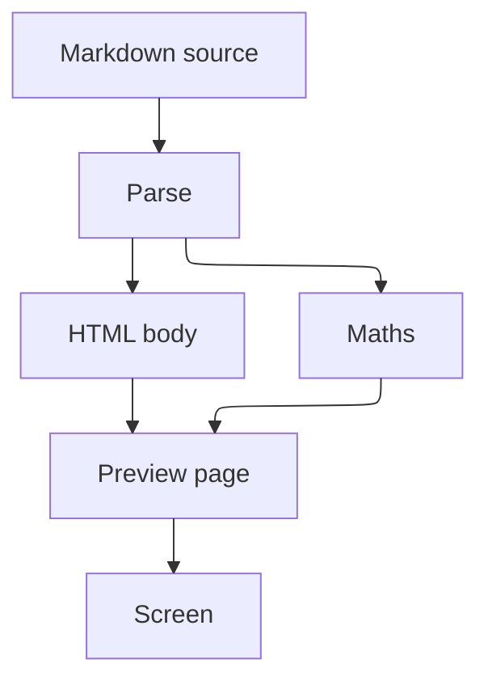
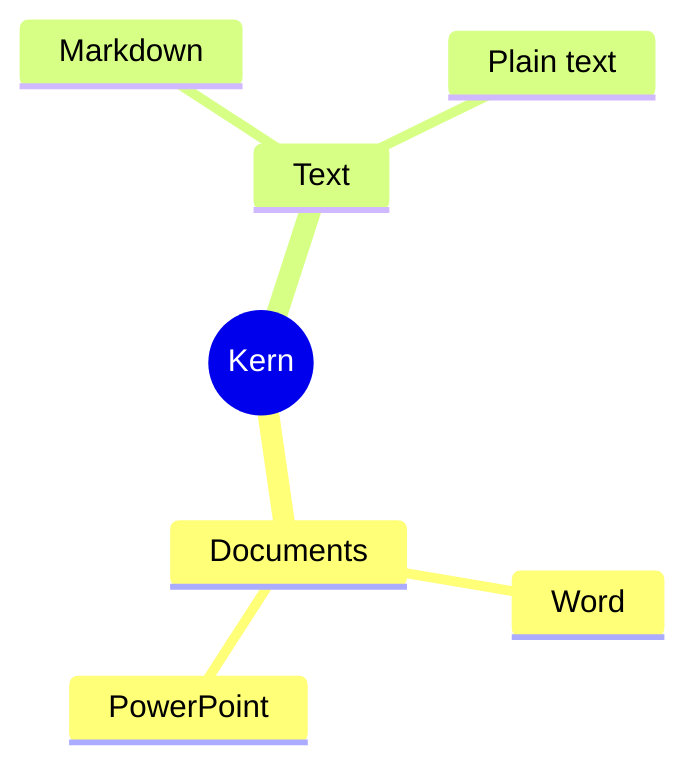
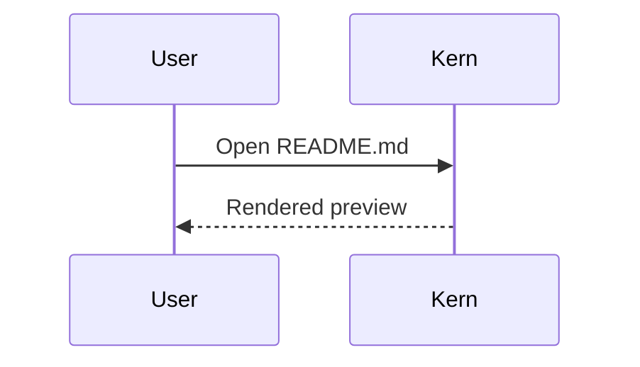

# Kern Markdown sample

This file uses every construct the Markdown preview renders. Open it in Kern and
switch between **Edit** and **Preview**.

Links to headings work inside the page: [jump to the tables](#tables).

## Text

Plain paragraph with **bold**, *italic*, ***bold italic***, ~~strikethrough~~,
`inline code`, <kbd>Ctrl</kbd> + <kbd>S</kbd>, H<sub>2</sub>O, E = mc<sup>2</sup>,
<mark>highlighted</mark> and <ins>underlined</ins> text.

A line ending in two spaces  
breaks the line, and so does a backslash\
at the end of a line.

Emoji shortcodes: :rocket: :tada: :+1: :white_check_mark: :heart: and plain 😀.

Escapes: \*not italic\*, \# not a heading, 5 \$ and \`not code\`.

## Headings

### Third level
#### Fourth level
##### Fifth level
###### Sixth level

Setext heading
--------------

## Links

- Inline: [Kern on GitHub](https://github.com/verycareful/kern "Kern")
- Autolinks: https://commonmark.org and www.example.com
- Angle brackets: <https://spec.commonmark.org>
- Email: <hello@example.com>
- Reference: [CommonMark spec][spec]
- In-page: [jump to footnotes](#footnotes)

[spec]: https://spec.commonmark.org/ "CommonMark Spec"

## Lists

1. First
2. Second
   - Nested bullet
   - Another
     1. Deeper numbered
     2. And again
3. Third

* Star bullets
+ Plus bullets

Task list:

- [x] Write the renderer
- [x] Bundle the scripts
- [ ] Test on a phone
  - [ ] Nested task

## Quotes and alerts

> A blockquote.
>
> > Nested quote with **formatting** and `code`.

> [!NOTE]
> Useful information.

> [!TIP]
> A helpful suggestion.

> [!IMPORTANT]
> Key information.

> [!WARNING]
> Needs attention.

> [!CAUTION]
> Risky action ahead.

## Code

Indented code block:

    plain indented code
    second line

```kotlin
// Kotlin with syntax colouring
data class Point(val x: Int, val y: Int)

fun main() {
    val p = Point(3, 4)
    println("Distance: ${Math.hypot(p.x.toDouble(), p.y.toDouble())}")
}
```

```python
def fib(n: int) -> int:
    return n if n < 2 else fib(n - 1) + fib(n - 2)
```

```json
{ "name": "kern", "offline": true, "permissions": [] }
```

```diff
- removed line
+ added line
```

```
Fence without a language stays plain.
```

## Tables

| Left | Centre | Right |
| :--- | :----: | ----: |
| a | b | c |
| `code` | **bold** | 1.00 |
| long cell text that wraps on a phone | x | 12,345.67 |

## Maths

Inline maths: $E = mc^2$, $\sqrt{a^2 + b^2}$ and $\sum_{i=1}^{n} i = \frac{n(n+1)}{2}$.
Prices stay text: it costs $5 and $10.

Display maths:

$$
\int_{-\infty}^{\infty} e^{-x^2}\,dx = \sqrt{\pi}
$$

```math
\begin{pmatrix} a & b \\ c & d \end{pmatrix}
\begin{pmatrix} x \\ y \end{pmatrix}
=
\begin{pmatrix} ax + by \\ cx + dy \end{pmatrix}
```

## Diagrams



The same kind of flowchart laid out by the ELK engine:







## Images

Local image next to this file:


Web image (shown as a placeholder, Kern never goes online):


HTML image with a width: 

## HTML blocks

<details>
<summary>Click to expand</summary>

Hidden content with **Markdown** inside.

</details>

<div align="center">Centred with an HTML attribute.</div>

<!-- An HTML comment is not shown. -->

<script>document.body.innerHTML = "scripts in a document never run";</script>

<a href="javascript:alert(1)" onclick="alert(2)">A link whose script is blocked</a>

## Footnotes

Here is a footnote reference[^1] and another[^note]. Inline footnotes work too^[like this one].

[^1]: The first footnote.
[^note]: A named footnote with **formatting**.

## Rules

Three kinds of horizontal rule:

---

***

___

End of sample.
